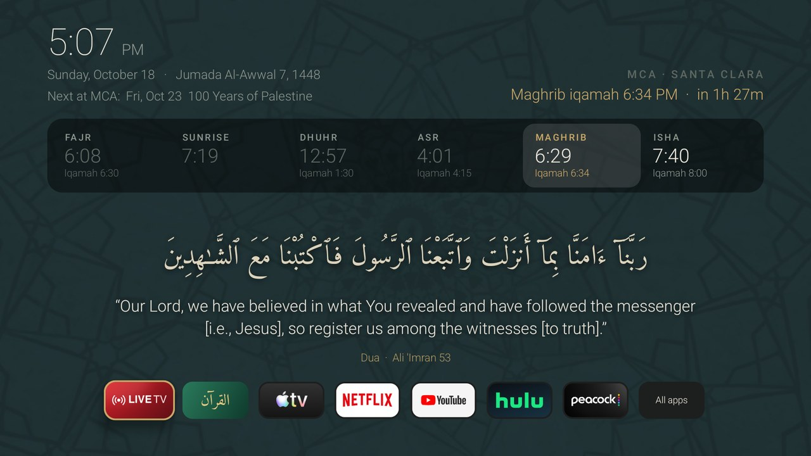
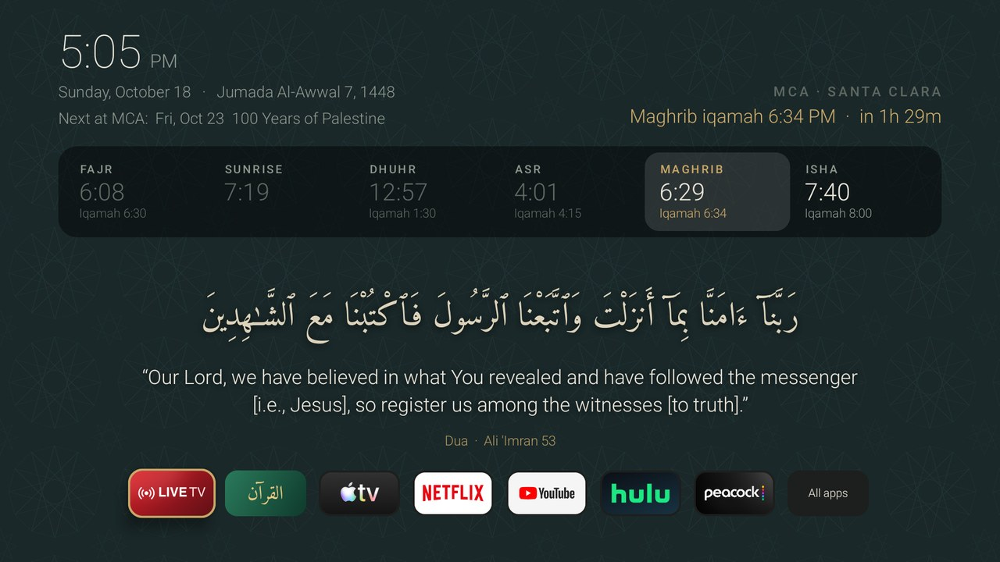
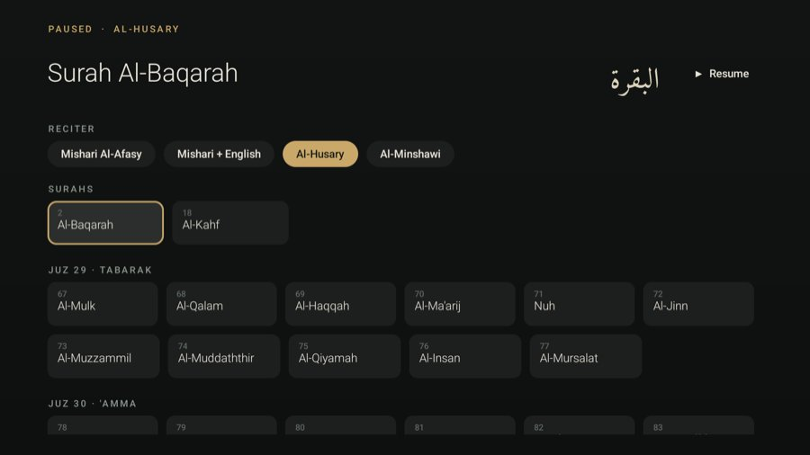

# Masjid TV for a TCL Google TV

> **A personal learning project.** This is what we built over a weekend to turn the family TV into
> something calmer: a home screen with our masjid's prayer times, the Quran our daughter is
> memorizing, and the apps we actually use, without the ads and autoplaying banners. It is shared so others can
> learn from it. It is **not affiliated with, endorsed by, or supported by** Masjidal, the Muslim
> Community Association (MCA), Quran.com, Pexels, TCL or Google. If you represent any of them and
> would like something changed or removed, please open an issue.



## What it does

- **Replaces the Google TV home screen** on a TCL Google TV (Android 14) with a quiet, dark home screen.
- **MCA Santa Clara prayer times** (adhan and iqamah) with a countdown to the next iqamah, the Hijri
  date, Jumu'ah times on Fridays, and the next event from MCA's public calendar.
- **Plays the adhan** at each adhan time, but only when the home screen is showing (never over a
  show, never in standby), with a separate recording for Fajr. Back stops it.
- **Rotating text every 5 minutes.** Half the slots go to the surah our daughter is memorizing
  (Al-Haqqah, ayah by ayah), each labelled with the theme of its passage.
  The other slots rotate through a Quran verse, a hadith from Imam an-Nawawi's Forty Hadith, a dua
  from the Quran, and a Juz 'Amma ayah for review.
- **After-prayer adhkar.** For 20 minutes after each iqamah, the screen steps through the adhkar to
  say after the prayer (from *Hisn al-Muslim*), one at a time with its count, including the ones
  that are only for Fajr or Maghrib.
- **Quran player** for Al-Baqarah, Al-Kahf, Juz 29 and Juz 30, with four reciters, pause/resume, and
  automatic play-on to the next surah.
- **App tiles** for Live TV, Quran, Apple TV, Netflix, YouTube, Hulu, Peacock and All apps.
- **Keeps Google TV's "Live" tab** (free channels such as CBC News and Willow) one click away.
- **Burn-in care:** every 3 minutes the whole layout eases a few pixels to a new position.
- **Calm by design:** one large ayah or hadith at a time, one quiet source line, and a tone-on-tone
  Islamic geometric background that changes once a day (seven of them: one drawn here, six photos of
  real tilework and ceilings muted into the same teal-grey).

| Dua slot | Quran player |
|---|---|
|  |  |

## How it works (and what we learned)

### 1. You can't simply replace the Google TV launcher

On this TV, Google's launcher (`com.google.android.apps.tv.launcherx`) is a system app with a higher
HOME-intent priority than anything you can install. `cmd package set-home-activity` "succeeds" but is
ignored. Launchers such as Projectivy work around this with an accessibility service that sends you
back to their screen whenever Google TV appears. That also blocks Google TV's **Live** tab, and we
wanted to keep that tab.

**Our approach:** an accessibility service ([`GuardService`](app/src/com/home/launcher/GuardService.java))
reads Google TV's tab bar from the accessibility tree, where the selected tab has `isSelected() == true`.
If any tab *other than Live* is showing (pressing Home, or Back from Live, lands on the "Home" tab), it
opens our home screen. The Live tile opens Google TV's Live tab directly through a deep link we
found in `dumpsys package` intent filters:

```
https://tv.google.com/destination/live  →  launcherx/.gateway.LauncherDeepLink
```

### 2. TCL-specific surprises

- **TCL blocks accessibility services by default.** The service showed "enabled" but never ran, and
  the log said `TclAppBoot: forbid bind service … callee_does't_have_OP_AUTO_START_permission`. Fix:
  `adb shell appops set com.home.launcher AUTO_START allow`.
- **Play Protect blocks sideloaded apps that target old Android versions**, so we target SDK 35.
- **Keys injected with `adb shell input keyevent` never reach an accessibility service's
  `onKeyEvent`** on this TV, which is another reason to watch windows instead of intercepting the Home key.

### 3. Prayer times, from most to least live

1. **Masjidal's public prayer-time endpoint** for MCA (the same data MCA's own screens show):
   `https://masjidal.com/api/v1/time/range?masjid_id=<id>&from_date=…&to_date=…`. It returns adhan,
   iqamah, the Hijri date and Jumu'ah times. Cached on the TV, refreshed every 6 hours.
2. **MCA's monthly schedule page** on mcabayarea.org (parsed), if Masjidal is unreachable.
3. **MCA's printed 2026 timetable** (a PDF on mcabayarea.org), parsed at build time into JSON, so the
   TV still has correct times with no internet.

We found these by reading MCA's website and looking at what MCA's own Masjidal display is configured
to use. We only use **public, unauthenticated** endpoints and files. Masjidal also has an
authenticated content API, which we deliberately did **not** use.

### 4. Quran text, translation and explanation

- Arabic text (Uthmani script) and the **Saheeh International** translation come from the
  [Quran.com API](https://api-docs.quran.com/).
- Each Al-Haqqah theme also carries a short **verbatim** excerpt from *Tafsir Ibn Kathir (abridged)*,
  also via Quran.com. (An earlier version showed it on screen; the calmer layout shows only the theme title.) [`tools/fetch_data.py`](tools/fetch_data.py) checks every quote against the
  source text and fails if one doesn't match. The theme titles (for example "The people of Thamud") are ours.
- We wanted *The Clear Quran* (Dr. Mustafa Khattab), but its text isn't licensed for use outside
  Quran.com, so we didn't use it.
- Rendered with the **Amiri Quran** font, which shapes Quranic Arabic far better than system fonts.

### 5. Building without Gradle

It's a small app, so [`app/build.sh`](app/build.sh) calls the Android SDK tools directly:
`aapt2 → javac → d8 → zipalign → apksigner`. The layout is built in code (no XML layouts), and the
whole app is about 10 small Java files.

## Setup

Requirements: Android SDK build-tools 36 and platform 36, JDK 11+, `adb`, Python 3 with Pillow,
`curl`, and `pdftotext` (poppler).

1. **On the TV:** Settings → System → About → click "Android TV OS build" 7 times, then
   Developer options → turn on **USB debugging** (network debugging).
2. **Connect:** `adb connect <TV_IP>:5555`, then accept the prompt on the TV.
3. **Download the third-party content** (it's not in this repo; see Credits):
   `python3 tools/fetch_data.py`
4. **Build and install:**
   ```sh
   ./app/build.sh
   adb install -r app/Home.apk
   adb shell appops set com.home.launcher AUTO_START allow          # TCL only
   adb shell settings put secure enabled_accessibility_services com.home.launcher/.GuardService
   adb shell settings put secure accessibility_enabled 1
   ```
5. Press Home on the remote.

**To try the adhan without waiting:** `adb shell am broadcast -n com.home.launcher/.AdhanTestReceiver`
(this only works from adb). **To preview the adhkar:**
`adb shell am start -n com.home.launcher/.HomeActivity --ei adhkarTest 3` (3 = Asr; `-1` to stop).

**To undo everything:** `adb shell settings delete secure enabled_accessibility_services`, then
`adb uninstall com.home.launcher`. Google TV's home screen is untouched and comes straight back.

### Making it yours

| What | Where |
|---|---|
| Masjid (Masjidal ID) | `MASJIDAL_ID` in [`Prayer.java`](app/src/com/home/launcher/Prayer.java) |
| Events calendar | `ICS` in [`Events.java`](app/src/com/home/launcher/Events.java) |
| Surah being memorized, and how far | `HAQQAH_CURRENT` in [`Daily.java`](app/src/com/home/launcher/Daily.java), themes in `fetch_data.py` |
| App tiles | `TILES` in [`HomeActivity.java`](app/src/com/home/launcher/HomeActivity.java) |
| Verses, duas, adhan recordings | the lists at the top of [`fetch_data.py`](tools/fetch_data.py) |
| Backgrounds | [`tools/wallpapers.py`](tools/wallpapers.py) (drawn pattern), [`tools/photo_wallpapers.py`](tools/photo_wallpapers.py) (Pexels photos, muted) |

## Credits and sources

None of the following content is committed here; `tools/fetch_data.py` downloads it at build time.
Please respect each source's terms.

- **[Masjidal](https://masjidal.com)**: MCA's prayer and iqamah times (public endpoint), the
  **adhan recordings** (Adhan 3 and Fajr 2 from Masjidal's public audio library), and the
  **Quran recitations** streamed by the player (Mishari Rashid Al-Afasy, Mishari with Saheeh English,
  Mahmoud Khalil Al-Husary, Muhammad Siddiq Al-Minshawi). This is the platform MCA uses for its
  screens and app. Thank you, Masjidal.
- **[Muslim Community Association (MCA), Santa Clara](https://mcabayarea.org)**: prayer schedule,
  the printed 2026 timetable, and the public events calendar.
- **[Quran.com](https://quran.com)** ([API](https://api-docs.quran.com/)): Quran text, the
  Saheeh International translation, *Tafsir Ibn Kathir (abridged)*, and surah metadata.
- **[Hisn al-Muslim](https://www.hisnmuslim.com)** (Fortress of the Muslim) by Sa'id al-Qahtani: the
  after-prayer adhkar (chapter 25, Arabic and English) via hisnmuslim.com's public API.
- **[hadith-api](https://github.com/fawazahmed0/hadith-api)** by fawazahmed0: Forty Hadith of Imam an-Nawawi (English).
- **[Amiri](https://github.com/aliftype/amiri)** by Khaled Hosny: Amiri Quran font,
  SIL Open Font License ([`OFL.txt`](app/assets/fonts/OFL.txt)). The font is included in the repo.
- **[Pexels](https://www.pexels.com/license/)** photographers (Pexels License), whose photos of Islamic
  geometric tilework and ceilings are muted into the backgrounds: sonniewing, nur-cosar,
  Rajneesh Narula, kovalskiolga, Aymene Kralifa (photo links in
  [`tools/photo_wallpapers.py`](tools/photo_wallpapers.py)). Not committed; downloaded at build time.
- Geometric backgrounds, the Live TV tile and the app icon were made for this project.

Built with help from [Claude Code](https://claude.com/claude-code).

## License

The source code is MIT ([LICENSE](LICENSE)). Third-party content keeps its own license and terms
(see above).
